 

## 👋 Chi sono · About me

<table>
<tr>
<td width="50%" valign="top">

### 👨‍🍳 Lo Chef · The Chef

🇮🇹 Chef con laurea in **Arti Culinarie** (Accademia Italiana di Cucina, Firenze). Ho cucinato tra Roma, Firenze, la Sicilia, Birmingham, Londra, Riva del Garda e dintorni e il fine dining di Copenhagen.

🇬🇧 Chef with a degree in **Culinary Arts** (Italian Culinary Academy, Florence). I've cooked across Rome, Florence, Sicily, Birmingham, London, Riva del Garda and Copenhagen fine dining.

- 🍝 Pasta fresca artigianale · *handmade fresh pasta*
- 🔥 Griglia a carbone Josper · *Josper charcoal grill*
- 🧪 Gastronomia molecolare · *molecular gastronomy*

</td>
<td width="50%" valign="top">

### 💻 Il Dev · The Dev

🇮🇹 IT enthusiast · Homelab & Automation. Software open source nato da problemi veri di casa.

🇬🇧 IT enthusiast · Homelab & Automation. Open-source software born from real problems at home.

- 🏠 Homelab nato su un Raspberry Pi, oggi su un mini PC Intel N150 con Docker · *started on a Raspberry Pi, now self-hosted on an Intel N150 mini PC*
- 🧩 Home Assistant · Traefik · Pi-hole · Nextcloud · WireGuard · tunnel Cloudflare
- 🌱 Co-fondatore di [**Arborae**](https://arborae.github.io) · *co-founder of Arborae*

</td>
</tr>
</table>

## ✨ Progetti in evidenza · Featured projects

<table>
<tr>
<td width="50%" valign="top">

#### 🏡 [floor3d-card mod](https://github.com/giosci1994/floor3d-card)

Il digital twin 3D della casa in Home Assistant: fork di floor3d-card con librerie aggiornate, editor visuale, mappe dei sensori, allarmi, cielo e meteo, telecamere. Nella lista ufficiale di HACS. 
*3D digital twin of your home for Home Assistant — a fork of floor3d-card with updated libraries and many new features, now in the HACS default store.*

[📖 Documentazione · Docs](https://giosci1994.github.io/floor3d-card/)

</td>
<td width="50%" valign="top">

#### 🐳 [d2ha — Docker to Home Assistant](https://github.com/arborae/docker2homeassistant)

Container Docker dentro Home Assistant, web UI moderna e autodiscovery MQTT. 
*Docker containers inside Home Assistant, modern web UI & MQTT autodiscovery.*

[📖 Documentazione · Docs](https://arborae.github.io/docker2homeassistant/)

</td>
</tr>
<tr>
<td width="50%" valign="top">

#### 🏋️ [WebApp Palestra](https://github.com/giosci1994/webapp-palestra)

Piattaforma a microservizi per la gestione della palestra: dashboard web, bot Telegram e scraper automatico. 
*Microservice platform for gym management: web dashboard, Telegram bot & automated scraper.*

`JavaScript` `Telegram Bot` · [🌐 Sito · Site](https://giosci1994.github.io/webapp-palestra/)

</td>
<td width="50%" valign="top">

#### 🍳 [WebApp Kitchen](https://github.com/giosci1994/kitchen-app)

Gestione di cucina e ristorante: PWA con inventario, ricette e prep list, pronta per Docker. 
*Kitchen & restaurant management PWA: inventory, recipes, prep lists, Docker ready.*

`TypeScript` `PWA` `Docker` · [🌐 Sito · Site](https://giosci1994.github.io/kitchen-app/)

</td>
</tr>
</table>

## 🧩 Progetti standalone · Standalone projects

<table>
<tr>
<td width="33%" valign="top">

#### 🎵 [Widget Spotify](https://github.com/giosci1994/widget-spotify)

Mini-telecomando Spotify nella system tray di Windows: brano in riproduzione, comandi e cambio dispositivo. 
*Spotify remote in the Windows tray: now playing, controls & device switch.*

`Electron` `Spotify Web API` · [🌐 Sito](https://giosci1994.github.io/widget-spotify/)

</td>
<td width="33%" valign="top">

#### 🔔 [PC-MQTT-Notifier](https://github.com/giosci1994/PC-MQTT-Notifier)

Notifiche di MQTT e Home Assistant in sovrimpressione su Windows, leggere e personalizzabili. 
*Lightweight Windows notification overlay for MQTT & Home Assistant.*

`Python` `MQTT` · [🌐 Sito](https://giosci1994.github.io/PC-MQTT-Notifier/)

</td>
<td width="33%" valign="top">

#### 🔧 [feature-overrides-registry](https://github.com/giosci1994/feature-overrides-registry)

Sblocca il supporto NVMe nativo sperimentale su Windows. 
*Unlocks experimental native NVMe support on Windows.*

`PowerShell` · [⬇️ Download](https://github.com/giosci1994/feature-overrides-registry/releases/latest)

</td>
</tr>
</table>

## 🌍 Traduzioni · Translations

<table>
<tr>
<td valign="top">

#### 🇮🇹 [Pokémon Rejuvenation — patch italiana](https://github.com/giosci1994/rejuvenation-ita-patch)

Traduzione italiana non ufficiale e completa di Pokémon Rejuvenation: il 99,9% dei testi del gioco. 
*Complete unofficial Italian translation patch for Pokémon Rejuvenation — 99.9% of the game's text.*

[🌐 Sito · Site](https://giosci1994.github.io/rejuvenation-ita-patch/)

</td>
</tr>
</table>

## 📦 Repository pubblici · Public repositories

Aggiornati automaticamente ogni giorno · updated automatically every day

<!-- REPOS:START -->

| Repository | Descrizione · Description | Linguaggio · Language | Ultimo push · Last push |
| :-- | :-- | :-- | :-- |
| [**webapp-palestra**](https://github.com/giosci1994/webapp-palestra) [🔗](<https://giosci1994.github.io/webapp-palestra/>) | 🏋️‍♂️ Complete microservice architecture platform for gym management with Web Dashboard, Telegram Bot & Automated Scraper. | JavaScript | ott 2026 |
| [**widget-spotify**](https://github.com/giosci1994/widget-spotify) [🔗](<https://giosci1994.github.io/widget-spotify/>) | 🎵 Spotify remote in the Windows system tray — now playing, controls & device switch (Echo/PC/phone). Electron + Spotify Web API… | JavaScript | ott 2026 |
| [**linktome**](https://github.com/giosci1994/linktome) [🔗](<https://giosci1994.github.io/linktome/>) | 🔗 All my links in one place: socials, projects & support. Day = Chef, night = Dev. Bilingual IT/EN, vanilla HTML/CSS/JS on GitHub… | HTML | ott 2026 |
| [**giosci1994.github.io**](https://github.com/giosci1994/giosci1994.github.io) [🔗](<https://giosci1994.github.io>) | 👨‍🍳💻 Personal site of Giovanni La Cascia — Chef by day, Dev by night. Split-screen, dual-theme, bilingual IT/EN. Vanilla… | HTML | ott 2026 |
| [**feature-overrides-registry**](https://github.com/giosci1994/feature-overrides-registry) [🔗](<https://github.com/giosci1994/feature-overrides-registry/releases/latest>) ⭐ 1 | Enable/Disable hidden Windows Feature Management overrides to unlock experimental Native NVMe support. Includes scripts, .exe… | PowerShell | ott 2026 |
| [**kitchen-app**](https://github.com/giosci1994/kitchen-app) [🔗](<https://giosci1994.github.io/kitchen-app/>) | Modern Kitchen & Restaurant Management Platform (PWA, Inventory, Recipes, Prep-Lists & Docker ready) | TypeScript | ott 2026 |
| [**PC-MQTT-Notifier**](https://github.com/giosci1994/PC-MQTT-Notifier) [🔗](<https://giosci1994.github.io/PC-MQTT-Notifier/>) | 🔔 Lightweight Windows notification overlay for MQTT & Home Assistant — customizable scale, transparency, fluid background, tray… | Python | ott 2026 |
| [**rejuvenation-ita-patch**](https://github.com/giosci1994/rejuvenation-ita-patch) [🔗](<https://giosci1994.github.io/rejuvenation-ita-patch/>) | 🇮🇹 Complete unofficial Italian translation patch for Pokémon Rejuvenation — 99.9% of the game's text | Python | set 2026 |

<!-- REPOS:END -->

## 🧰 Il mio stack · My toolbox

**Homelab & Automation**

**Dev**

## 📊 GitHub

<picture>
  <source media="(prefers-color-scheme: dark)" srcset="https://raw.githubusercontent.com/giosci1994/giosci1994/output/stats-dark.svg" />
  
</picture>
<picture>
  <source media="(prefers-color-scheme: dark)" srcset="https://raw.githubusercontent.com/giosci1994/giosci1994/output/languages-dark.svg" />
  
</picture>

<picture>
  <source media="(prefers-color-scheme: dark)" srcset="https://raw.githubusercontent.com/giosci1994/giosci1994/output/activity-dark.svg" />
  
</picture>

---

*fatto con ❤️ tra fornelli e container · made with ❤️ between stoves and containers*

☕ Se un mio progetto ti è utile, puoi [offrirmi un caffè](https://buymeacoffee.com/giosci1994u) · *if one of my projects helps you, you can [buy me a coffee](https://buymeacoffee.com/giosci1994u)*

